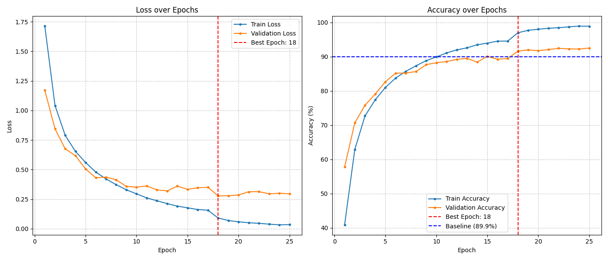

# ResNet Unified Convolutional Network (Res_UCN)

Res_UCN is an undergraduate group project exploring a ResNet-inspired
architecture for CIFAR-10 image classification. It combines custom convolution,
normalization, activation, and early-stopping components to investigate accuracy
and parameter efficiency relative to a published ResNet-18 baseline.

This repository is Edward Ooi Wee Xue's portfolio copy of the team project. My
primary contribution was developing **Channel Importance Assignment Convolution
(CIAC)**, implemented as `CIA_Conv2D`. The complete architecture and experimental
results are the work of the project team.

## My contribution: CIAC

CIAC computes input-dependent channel weights before applying convolution:

```text
s = BatchNorm(GlobalAveragePool(X))
w = sigmoid(T * s)
Y = Conv2D(X * w)
```

Global average pooling summarizes each input channel. Batch normalization
normalizes those summaries, and a learnable scalar temperature `T` controls the
sigmoid gating. The resulting weights scale the input channels before feature
extraction. In the notebook, the implementation appears under **Novelty algorithm
5: Channel Importance Assignment Convolution (CIAC)**.

## Architecture

The network has four stages, each containing an ADSGC residual block, a CIAC
residual block, and max pooling. The stage widths are 64, 128, 256, and 256
channels. Global average pooling, dropout, and a linear classifier produce the
10 CIFAR-10 class scores.

The team implemented five main components:

- **ADSGC:** fuses standard and dilated convolution using learned gates.
- **CIAC:** weights input channels before convolution.
- **Weighted Batch Normalization:** estimates normalization statistics using
  activation-dependent weights.
- **Quinsh:** a learnable activation combining shifted sigmoid gating and a
  linear residual term.
- **DE-Stopping:** combines validation-loss checkpointing with energy and
  entropy signals for stopping decisions.

## Recorded results

The original saved notebook reports the following results from one training run:

| Metric | Res_UCN |
| --- | --- |
| Test accuracy at the selected checkpoint | 91.45% |
| Test loss at the selected checkpoint | 0.2996 |
| Checkpoint selected by lowest validation loss | Epoch 18 |
| Model parameters | 3,447,630 |
| Time to the selected checkpoint | 17 min 17 sec |
| Complete training run | 25 epochs, 24 min 2 sec |
| Reported training hardware | Google Colab NVIDIA Tesla T4 |

The course report compared these results with a published ResNet-18 baseline
reporting 89.9% accuracy and approximately 11.2 million parameters. This is a
**1.55 percentage point** accuracy difference and approximately **69% fewer
parameters**. The baseline was not retrained in this repository, and its hardware
environment was unspecified, so the reported timing comparison is not a
controlled hardware benchmark.

These are full-model results. The supplied experiment does not isolate the
accuracy contribution of CIAC through an ablation study. The 91.45% figure is
the test accuracy associated with the lowest-validation-loss checkpoint, rather
than the highest test accuracy observed across all epochs. Results have not
been independently reproduced as part of preparing this repository.



## Repository files

```text
res_ucn/
|-- README.md
|-- requirements.txt
|-- .gitignore
|-- Res_UCN.ipynb
|-- Res_UCN_Model.pt
`-- Res_UCN_Training_Graph.png
```

- `Res_UCN.ipynb`: component definitions, data preparation, training, evaluation,
  and the original saved outputs.
- `Res_UCN_Model.pt`: pretrained state dictionary selected by validation loss.
- `Res_UCN_Training_Graph.png`: saved training and validation curves.

CIFAR-10 is downloaded automatically into `data/` by the notebook. The dataset
and generated training-record files are excluded from Git. The project report
and presentation files are not included.

## Environment setup

The notebook records Python 3.11.0. The original package versions were not
recorded; `requirements.txt` lists the direct dependencies without claiming a
version-pinned reproduction environment.

From this project folder, create a virtual environment and install dependencies:

```powershell
py -3.11 -m venv .venv
.\.venv\Scripts\python.exe -m pip install -r requirements.txt
.\.venv\Scripts\python.exe -m jupyterlab
```

Open `Res_UCN.ipynb` and select the kernel for that virtual environment. For
GPU execution, install the PyTorch/torchvision builds matching your system using
the [official PyTorch installation guide](https://pytorch.org/get-started/locally/).
The notebook chooses CUDA when available and CPU otherwise; training on CPU
will take substantially longer than the recorded GPU run.

## Evaluate the supplied checkpoint

Run the notebook's setup cells in order, from **Import Library** through
**Model Setup**, including the dataset and helper-function cells. This downloads
CIFAR-10 if needed. Skip the **Model Training** cell, then run the following in
a new notebook cell:

```python
state_dict = torch.load("Res_UCN_Model.pt", map_location=DEVICE)
model.load_state_dict(state_dict)
model.eval()

loss, accuracy = test(
    model, test_loader, criterion, "Pretrained Res_UCN", DEVICE
)
print(f"Test accuracy: {accuracy:.2f}%")
```

`map_location=DEVICE` lets PyTorch load the CUDA-saved checkpoint onto the
selected device. The original notebook's loading cells omit this argument;
the example above is the intended route for CPU evaluation as well as GPU
evaluation. This route has not yet been execution-tested in a clean environment.

## Train the model

Run the setup cells through **Model Setup**, followed by **Model Training**.
The notebook uses a batch size of 64, an initial learning rate of 0.001, Adam,
and a maximum of 30 epochs, with a validation-loss scheduler and DE-Stopping.

The training cell skips training when `Res_UCN_Record.pt` already exists.
Training saves or replaces `Res_UCN_Model.pt`, `Res_UCN_Record.pt`, and
`Res_UCN_ES_Record.pt`. Use a separate copy of the project folder for experiments
if you want to preserve the supplied checkpoint. The plotting cells can also
write `Res_UCN_Training_Graph.png` and use the generated records.

## Reproducibility notes

- The original notebook does not set random seeds for initialization, splitting,
  shuffling, or augmentation. Retraining can produce different results.
- Training and validation are created using a 90/10 random split of the same
  dataset object. Consequently, the validation subset also uses the training
  augmentation. A future experiment should use a separate validation transform.
- The test set is evaluated during training. The reported checkpoint is selected
  by validation loss; a future evaluation protocol should reserve test-set
  evaluation for the selected final model.
- The supplied notebook combines training and evaluation in one workflow. Use
  the pretrained-evaluation instructions above to avoid unintentionally starting
  a new training run.

## Team credits

| Team member | Code contribution |
| --- | --- |
| Derol Chong Chun Kit | Team leader; Adaptive Dynamic-Scale Gated Convolution |
| Chua Kian Hoong | Weighted Energy-Entropy Stopping |
| Edward Ooi Wee Xue | Channel Importance Assignment Convolution (CIAC) |
| Wilbert Andrew Yonathan | Quinsh activation function |
| Siah Jie Sheng | Data preprocessing and residual-block integration |
| Wang XinYi | Weighted Batch Normalization |

The architecture, training experiment, and documentation were produced as a
collaborative undergraduate project. This portfolio copy highlights my CIAC
contribution while crediting the other team members' work.
